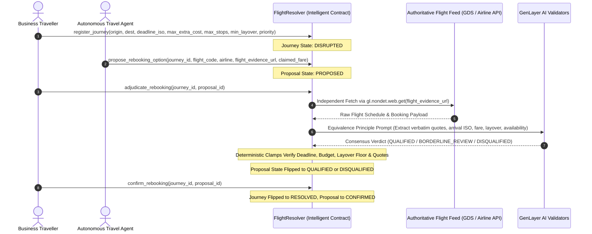

# FlightResolver — Autonomous On-Chain Travel Disruption & Flight Rebooking Arbiter

> **GenLayer Builder Track**: Intelligent Contracts  
> **Network**: GenLayer StudioNet (Chain ID: `61999`)  
> **Runtime**: `py-genlayer:1jb45aa8ynh2a9c9xn3b7qqh8sm5q93hwfp7jqmwsfhh8jpz09h6`  
> **Deployed Contract (StudioNet)**: [`0x36f51b3Bf168880A2fb1EDf986c3f919Ddc1CA72`](https://explorer-studio.genlayer.com/address/0x36f51b3Bf168880A2fb1EDf986c3f919Ddc1CA72)

An autonomous on-chain travel disruption resolution and rebooking arbiter built on GenLayer. `FlightResolver` protects corporate travel managers, passengers, and autonomous travel agents from hallucinations, missed arrival deadlines, hidden fare surges, and dangerously tight connection layovers during flight disruptions.

Unlike contracts that trust caller-supplied flight schedule arguments, `FlightResolver` **independently acquires and validates authoritative flight feeds on-chain** using `gl.nondet.web.get()`, extracts mandatory verbatim quote evidence under the Equivalence Principle (`gl.eq_principle.prompt_non_comparative`), and enforces deterministic safety clamps in code.

---

## 1. Architecture & Verification Flow



---

## 2. Live On-Chain Deployments & Verified StudioNet Manifest

All transactions below were executed under full multi-validator consensus on StudioNet (Chain ID: `61999`):

| Step | Method | Tx Hash | Result & Consensus State |
| :---: | :--- | :--- | :--- |
| **1** | `deploy` | [`0xef3ac9265d...`](https://explorer-studio.genlayer.com/tx/0xef3ac9265daedeec5543108601c3f65113539aa034a1aec554dfc1d9b78022c5) | **FINALIZED** (Contract deployed at `0x36f5...CA72`) |
| **2** | `register_journey` (Journey 1) | [`0xae32a9e071...`](https://explorer-studio.genlayer.com/tx/0xae32a9e071dad9e00bf49ac549a32af48724ce37a095f3e6b627ffd05306ac5a) | **FINALIZED** (LHR $\rightarrow$ JFK, deadline 18:30Z, min layover 60m) |
| **3** | `propose_rebooking_option` (J1) | [`0x68961bec93...`](https://explorer-studio.genlayer.com/tx/0x68961bec93156ca370d171937d2a52052a9077eba326e04254c60284e270a53b) | **FINALIZED** (Proposed BA177 with authoritative feed URL) |
| **4** | `adjudicate_rebooking` (J1) | [`0x4ef59fbae0...`](https://explorer-studio.genlayer.com/tx/0x4ef59fbae0ee630bc384f133127ec4e342a7878cab433f9b4074df1e0daa40fd) | **FINALIZED**: `QUALIFIED`<br>Verified arrival 16:15Z (2h15m before deadline), $150 fare, 0 stops<br>Quote: `"\"arrival_time_iso\": \"2026-11-05T16:15:00Z\""` |
| **5** | `confirm_rebooking` (J1) | [`0x0d950aea88...`](https://explorer-studio.genlayer.com/tx/0x0d950aea884235c878e8902bb4bbbe8f9b009c3a6eb96999f8750091daa505ca) | **FINALIZED**: State transitioned to `RESOLVED` / `CONFIRMED` |
| **6** | `register_journey` (Journey 2) | [`0x678983a43b...`](https://explorer-studio.genlayer.com/tx/0x678983a43bbd66150e28338193b1ebe46ffaa73656e5bbe3c7c509216b0e9505) | **FINALIZED** (For abuse defense demonstration) |
| **7** | `propose_rebooking_option` (J2) | [`0xa8ced6adb2...`](https://explorer-studio.genlayer.com/tx/0xa8ced6adb2ac8886b588cb350234f775f7cc9e6be304242b5c3d31908b272cc4) | **FINALIZED** (Adversarial proposal: AF1128 with 25-minute connection) |
| **8** | `adjudicate_rebooking` (J2) | [`0xd2f7e73ef8...`](https://explorer-studio.genlayer.com/tx/0xd2f7e73ef8b630d35162345304450fbcc9c34ba03db995998480bad50bba04c1) | **FINALIZED**: `DISQUALIFIED`<br>**Abuse Intercepted**: Caught 25-minute layover below 60m floor<br>Quote: `"\"layover_minutes\": 25"` |

Full transaction parameters and read-back states are documented in [`deploy/proof.json`](file:///C:/Users/user/Desktop/genlayer-flight-resolver/deploy/proof.json).

---

## 3. Four Deterministic Safety Clamps

1. **Independent Authoritative Acquisition**: Contract fetches flight schedules directly via `gl.nondet.web.get()`. Never relies on caller-supplied arrival times or fares.
2. **Mandatory Verbatim Quoting**: AI validators must extract an exact substring from the fetched airline payload. If missing, contract clamps to `DISQUALIFIED`.
3. **Hard Arrival Deadline Clamp**: If arrival lands after `arrival_deadline_iso`, contract forcefully clamps to `DISQUALIFIED`.
4. **Layover Safety Floor Clamp**: If connection time is under `min_layover_mins`, contract forcefully clamps to `DISQUALIFIED`.

---

## 4. Local Testing & Verification

```bash
uv run python -m unittest discover -s tests
```

Output:
```
........
----------------------------------------------------------------------
Ran 8 tests in 0.001s

OK
```
