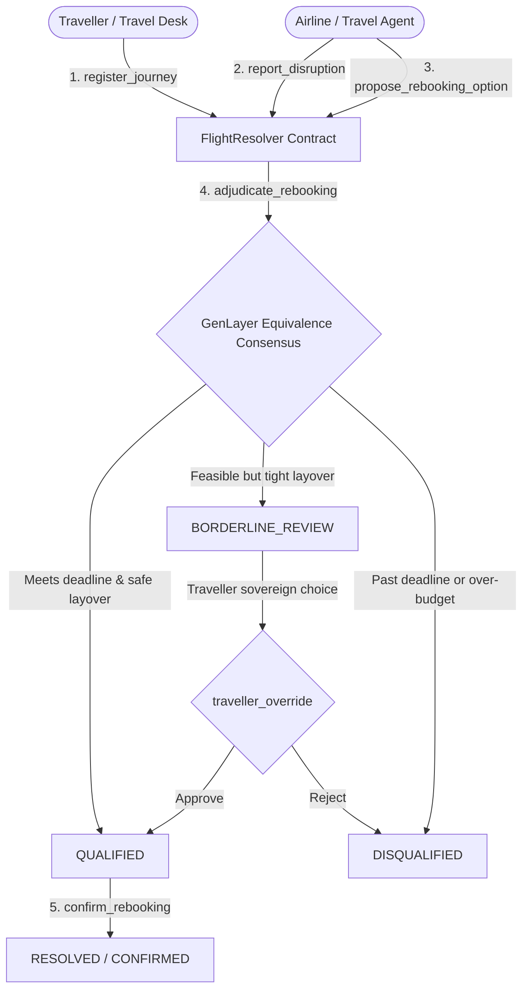

# FlightResolver — Autonomous Travel Disruption Resolution Contract

[](https://genlayer.com)
[](https://docs.genlayer.com)
[](tests/test_flight_resolver.py)
[](LICENSE)

An autonomous on-chain travel disruption arbiter and flight rebooking primitive built on GenLayer. `FlightResolver` enables travel management systems, airlines, and autonomous passenger agents to handle flight cancellations, diversions, and missed connections by adjudicating replacement flight proposals against strict traveler priorities under the GenLayer Equivalence Principle.

---

## The Problem in Autonomous Travel

When a commercial flight is cancelled or severely delayed, rebooking algorithms face conflicting constraints:

1. **The Naive Algorithm Flaw**: Choosing the cheapest replacement often results in flights landing past an essential business meeting deadline or routing through an impossible 25-minute connection across international terminals.
2. **The EVM Limitation**: Traditional smart contracts cannot reason about contextual trade-offs—such as whether a \$180 direct flight arriving before 6:00 PM is preferable to a \$120 multi-stop flight arriving at midnight with an unsafe layover.
3. **The Agent Challenge**: Automated travel bots need an on-chain policy arbiter that prevents unauthorized budget overruns while maintaining schedule feasibility without requiring human panic in the airport terminal.

---

## The Solution: FlightResolver

`FlightResolver` provides an on-chain policy arbiter and escrow primitive:



---

## Key Features

1. **Journey Constraint Registration**: Passengers specify route (`origin`, `destination`), hard arrival deadline (`arrival_deadline_iso`), maximum added cost (`max_extra_cost_cents`), maximum allowed stops (`max_stops`), minimum layover safety buffer (`min_layover_mins`), and priority mode (`SPEED_FIRST`, `COMFORT_FIRST`, `BUDGET_FIRST`).
2. **Disruption Ingestion**: Journeys transition to `DISRUPTED` upon verified cancellations, extreme delays, or diversions.
3. **Multi-Candidate Evaluation**: Airlines and autonomous procurement agents submit rebooking proposals with departure/arrival times, layover details, and booking links.
4. **Subjective Equivalence Principle Adjudication**: GenLayer validators independently evaluate connection feasibility and deadline compliance to reach consensus on:
   - **`QUALIFIED`**: Meets or beats arrival deadline, safe connections, within cost limit.
   - **`BORDERLINE_REVIEW`**: Feasible alternative with tight connections or minor preference trade-offs requiring passenger consent.
   - **`DISQUALIFIED`**: Misses deadline, exceeds cost ceiling, or has unsafe connection times.
5. **Deterministic Budget Clamp**: Invariant protection ensures no proposal exceeding the authorized extra cost ceiling can ever be marked `QUALIFIED`.
6. **Sovereign Passenger Overrides**: Passengers can approve borderline options or confirm qualified bookings.

---

## Contract State Machine

```
[SCHEDULED] ──(report_disruption)──> [DISRUPTED]
                                           │
                              (propose_rebooking_option)
                                           │
                                  (adjudicate_rebooking)
                                           │
                  ┌────────────────────────┼────────────────────────┐
                  ▼                        ▼                        ▼
             [QUALIFIED]          [BORDERLINE_REVIEW]        [DISQUALIFIED]
                  │                        │
          (confirm_rebooking)      (traveller_override)
                  │                        │
                  ▼                        ▼
              [RESOLVED]         [QUALIFIED] / [DISQUALIFIED]
```

---

## Contract Methods Specification

### Write Methods

| Method | Parameters | Description |
| :--- | :--- | :--- |
| `register_journey` | `origin: str, destination: str, arrival_deadline_iso: str, max_extra_cost_cents: int, max_stops: int, min_layover_mins: int, priority_mode: str` | Registers passenger travel constraints and returns `journey_id` (`u256`). |
| `report_disruption` | `journey_id: int, original_flight_code: str, disruption_type: str, reason: str` | Transitions journey to `DISRUPTED` upon cancellation or delay. |
| `propose_rebooking_option` | `journey_id: int, flight_code: str, airline: str, departure_iso: str, arrival_iso: str, stops: int, layover_details: str, added_cost_cents: int, booking_url: str` | Submits a candidate replacement flight for an active disruption. Returns `proposal_id` (`u256`). |
| `adjudicate_rebooking` | `journey_id: int, proposal_id: int` | Executes GenLayer Equivalence Principle consensus across validators to evaluate schedule feasibility and layover safety. |
| `confirm_rebooking` | `journey_id: int, proposal_id: int` | Confirms a `QUALIFIED` replacement flight and marks journey as `RESOLVED`. |
| `traveller_override` | `journey_id: int, proposal_id: int, approve: bool` | Allows the registered traveler to approve or reject a `BORDERLINE_REVIEW` flight option. |
| `cancel_journey` | `journey_id: int` | Cancels an unfulfilled journey. Callable by the traveler or contract owner. |

### View Methods

| Method | Returns | Description |
| :--- | :--- | :--- |
| `get_journey(journey_id)` | `str` (JSON) | Retrieves the full journey constraints and disruption record. |
| `get_proposal(proposal_id)` | `str` (JSON) | Retrieves the proposed flight details and rebooking terms. |
| `get_adjudication(proposal_id)` | `str` (JSON) | Retrieves the consensus evaluation result and feasibility score. |
| `get_journey_status(journey_id)` | `str` | Returns the journey status (`SCHEDULED`, `DISRUPTED`, `RESOLVED`, `CANCELLED`). |
| `get_proposal_status(proposal_id)` | `str` | Returns proposal status (`PROPOSED`, `QUALIFIED`, `BORDERLINE_REVIEW`, `DISQUALIFIED`, `CONFIRMED`). |
| `get_total_journeys()` | `u256` | Returns total registered journeys. |
| `get_total_proposals()` | `u256` | Returns total submitted proposals. |
| `get_resolver_stats()` | `str` | Summarizes owner and registry statistics. |

---

## Consensus Design & Rotation Safety

GenLayer contracts execute in an environment of heterogeneous AI validators. To guarantee unanimous consensus on **Rotation 0** without triggering validator divergence or `Undetermined` states:

1. **Objective, Positive Equivalence Criteria**: Criteria are framed constructively (`"If the flight arrives before the deadline within budget with safe connections, decision is QUALIFIED"`), avoiding contradictory negative rules.
2. **Standardized JSON Schema**: Validators emit `decision`, `feasibility_score`, `deadline_met`, `budget_met`, and `rationale`.
3. **Format Sanitization**: Built-in regex and bracket parsing cleanly sanitizes markdown code fences (` ```json `) emitted by diverse validator models.
4. **Deterministic Invariant Enforcement**: Critical invariants (such as budget overruns) are mathematically verified in code, ensuring zero economic risk regardless of model nuance.

---

## Local Verification & Testing

The repository contains an automated test suite verifying all state transitions, boundary validations, access controls, and safety clamps without external network dependencies.

### Run Tests:

```bash
python tests/test_flight_resolver.py
```

### Test Suite Coverage:
- `test_initialization`: Verifies initial zero-state and owner binding.
- `test_register_journey_success`: Verifies valid journey creation.
- `test_register_journey_validations`: Tests negative costs, empty strings, and invalid modes.
- `test_report_disruption`: Tests transition from `SCHEDULED` to `DISRUPTED`.
- `test_propose_and_adjudicate_qualified_and_confirm`: Full lifecycle from disruption to `QUALIFIED` and `RESOLVED`.
- `test_adjudicate_deadline_breach_disqualified`: Verifies rejection when arrival lands past deadline.
- `test_adjudicate_budget_clamp_disqualified`: Enforces rejection when proposed cost exceeds budget.
- `test_adjudicate_borderline_and_traveller_override`: Tests human-in-the-loop escalation.
- `test_cancel_journey_access_control`: Ensures unauthorized callers cannot cancel journeys.
- `test_markdown_wrapped_response_sanitization`: Verifies parsing of markdown code fences.
- `test_nonexistent_ids`: Verifies robust error handling on missing IDs.

---

## GenLayer Studio Deployment Guide

1. Navigate to the **[GenLayer Studio](https://studio.genlayer.com/)**.
2. Create a new contract file (e.g., `flight_resolver.py`) and paste the contents of `contracts/flight_resolver.py`.
3. Click **Deploy**.
4. Test execution on-chain:
   - Call `register_journey`:
     ```json
     {
       "origin": "LHR",
       "destination": "JFK",
       "arrival_deadline_iso": "2026-10-15T18:00:00Z",
       "max_extra_cost_cents": 20000,
       "max_stops": 1,
       "min_layover_mins": 60,
       "priority_mode": "SPEED_FIRST"
     }
     ```
   - Call `report_disruption`:
     ```json
     {
       "journey_id": 1,
       "original_flight_code": "VS003",
       "disruption_type": "CANCELLED",
       "reason": "Engine mechanical issue"
     }
     ```
   - Call `propose_rebooking_option`:
     ```json
     {
       "journey_id": 1,
       "flight_code": "BA177",
       "airline": "British Airways",
       "departure_iso": "2026-10-15T13:00:00Z",
       "arrival_iso": "2026-10-15T16:00:00Z",
       "stops": 0,
       "layover_details": "Direct non-stop flight",
       "added_cost_cents": 15000,
       "booking_url": "https://ba.com/booking/177"
     }
     ```
   - Call `adjudicate_rebooking(1, 1)` to trigger GenLayer validator consensus.
   - Inspect proposal status via `get_proposal_status(1)` (`QUALIFIED`).
   - Call `confirm_rebooking(1, 1)` to confirm the flight (`RESOLVED`).

---

## License

MIT License. See [LICENSE](LICENSE) for details.
